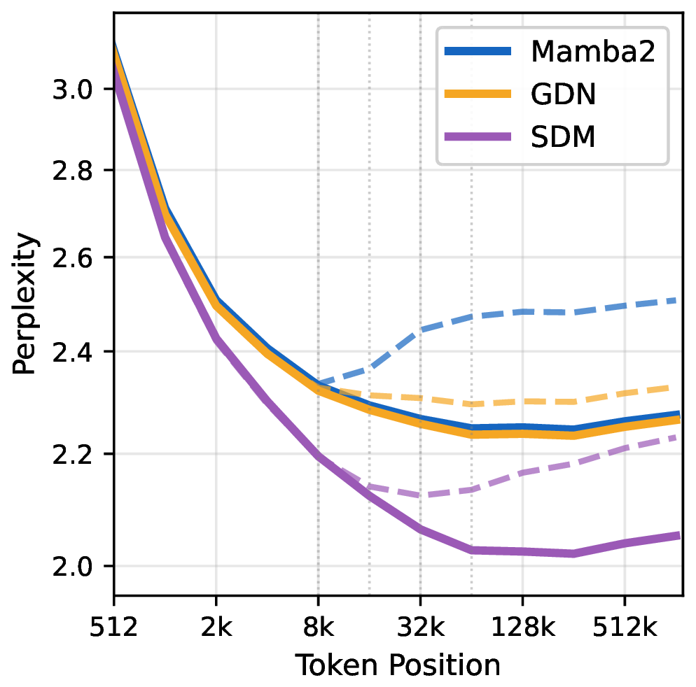
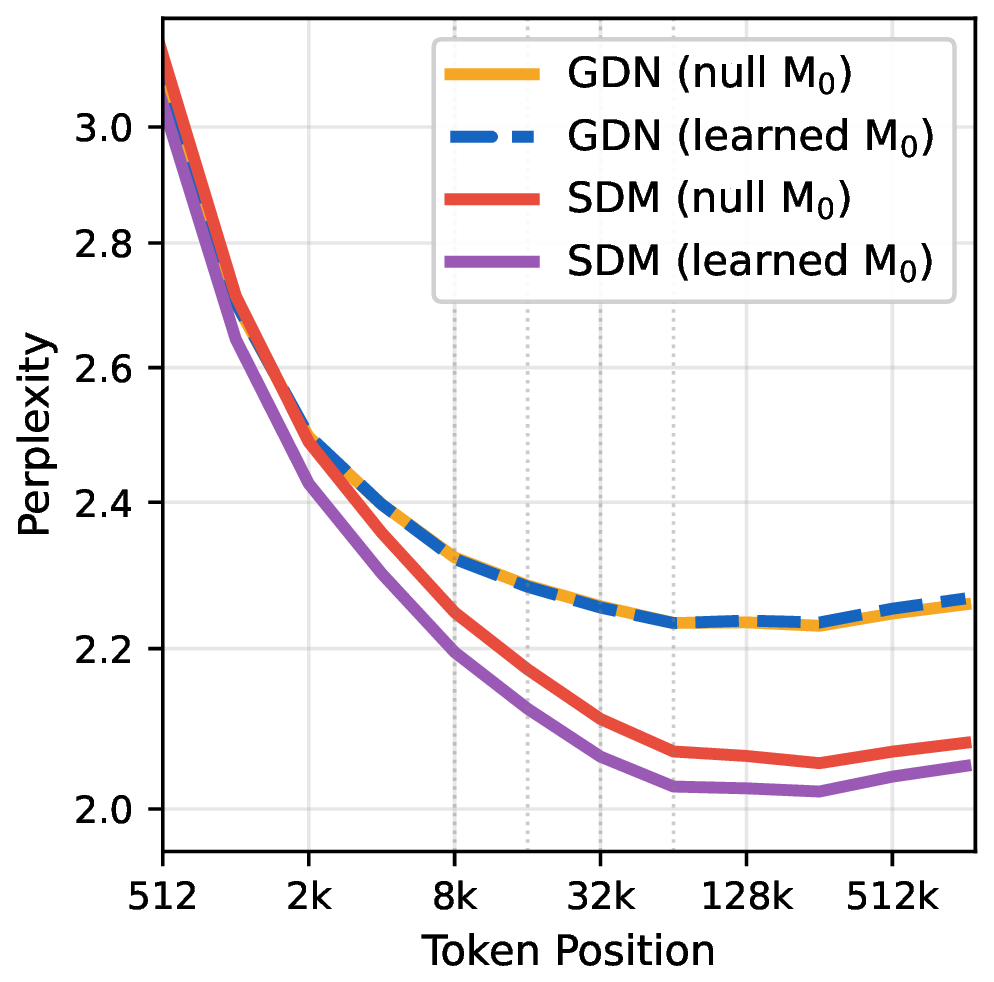
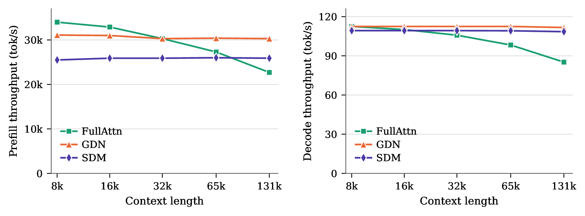
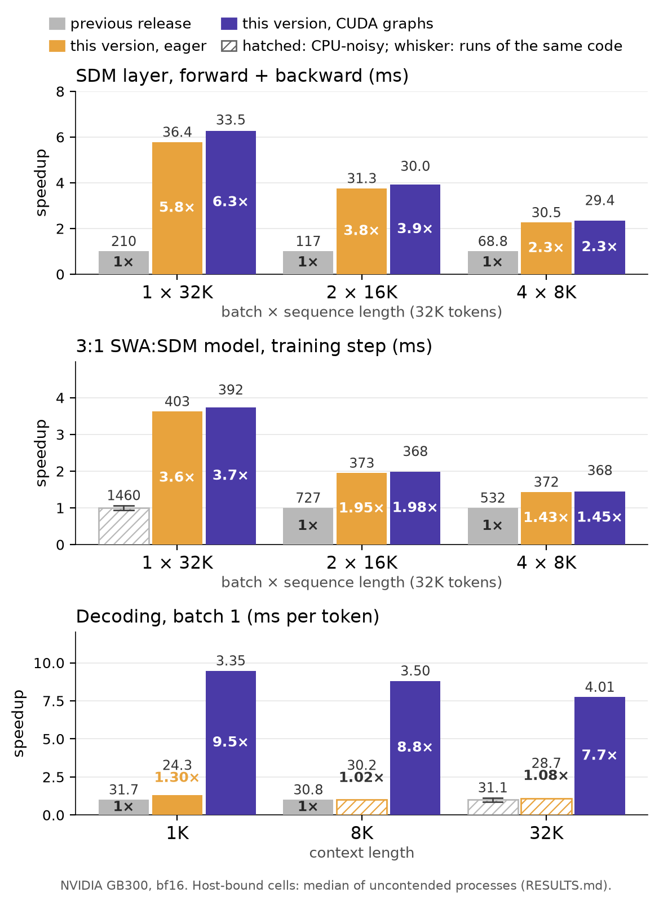

# Sparse-Delta-Memory (SDM)

<!-- markdownlint-disable html -->
<div align="center" style="line-height: 1;">
  <a href="https://lcabannes.github.io/sdm-blogpost" target="_blank" style="margin: 2px;">
    
  </a>
  <a href="https://arxiv.org/abs/2607.07386" target="_blank" style="margin: 2px;">
    
  </a>
  <a href="https://github.com/facebookresearch/sparse-delta-memory" target="_blank" style="margin: 2px;">
    
  </a>
  <a href="LICENSE" style="margin: 2px;">
    
  </a>
</div>
<hr>

Reference implementation of **Sparse-Delta-Memory** — a sparse memory bank with
deltanet-style gating (the *Gated Memory Controller* from the paper). SDM is a
sequence mixer that reads from and writes to a large sparse memory via product
keys, with gated (forget/input) delta-rule updates.

This repository is a fork of [Meta Lingua](https://github.com/facebookresearch/lingua);
the SDM-specific code is the `sparse_delta_memory` package (`pip install sparse-delta-memory`),
which the training code here imports. For everything
else (data prep, training/eval scaffolding, `stool`), refer to the
[Meta Lingua README](https://github.com/facebookresearch/lingua).

## Results

Results from the paper, and the speed of this version against the previous release. All
models use sliding-window attention (SWA) as the local layer and vary the **global** layer;
SDM and GDN are matched in FLOPs and (non-memory) parameters.

### Perplexity by token position (code, 1M-token documents)

<p align="center">
  
  &nbsp;&nbsp;
  
</p>

**Left (Fig. 4):** perplexity by token position on code data (1.4B; solid = 128k long-context
finetuned, dashed = pre-trained). SDM reaches lower perplexity than Mamba2/GDN — already at
short context (a benefit of the learned initial state) and increasingly at long context.
**Right (Fig. 5):** learned-initial-state ($\mathbf{M_0}$) ablation — learning $\mathbf{M_0}$
helps SDM but not GDN.

### Speed

<p align="center"></p>

From the paper: inference throughput at 8B on one H100, measured with the paper's own implementation
(not this repository's code).

<p align="center"></p>

This version (deterministic kernels) against the previous release (`183e7df`) on
NVIDIA GB300 GPUs in bf16: one SDM layer (forward + backward) and the paper's 3:1 SWA:SDM model
(training step) at 32K tokens per step, and decoding at batch 1. Speedup = the previous release's
time / this version's time. *CUDA graphs*: this version's layer option `cuda_graph=True` for
training, its CUDA-graph decode step for decoding.

**Determinism.** Outputs, the final memory bank and every gradient are bitwise identical across
repeated runs, fresh processes, CUDA-graph replays and GPUs of the same type
([details](sparse_delta_memory/README.md#determinism)).
Bitwise-repeatable decode on H100 needs the generator option `deterministic_attention=true`; it is
slower.

**Known limitations.** With a cold extension cache the first call compiles the CUDA extensions:
about 6 minutes (no-grad) to 10 minutes (training) on a GB300 node.

Full tables, method and checks: [`benchmarks/RESULTS.md`](benchmarks/RESULTS.md).

## Quick start

### The package

The layer and its kernels install as the `sparse_delta_memory` package, from PyPI or from a
checkout of this repository:

```bash
pip install torch==2.13.0 --index-url https://download.pytorch.org/whl/cu130   # first, the tested CUDA build of PyTorch
pip install sparse-delta-memory          # or, in a checkout: pip install .
```

```python
import torch
from sparse_delta_memory import SparseDeltaMemory, SparseDeltaMemoryArgs

args = SparseDeltaMemoryArgs(dim=2048, num_heads=2, slots_per_head=65536,
                             num_writes=64, num_reads=64, chunk_size=64)
layer = SparseDeltaMemory(args, layer_id=0).cuda()
layer.init_weights()
layer = layer.to(torch.bfloat16)
x = torch.randn(2, 4096, 2048, device="cuda", dtype=torch.bfloat16, requires_grad=True)
y, _ = layer(x)                       # [batch, tokens, dim]; the bank advances in place
y.float().square().mean().backward()  # deterministic kernels (see Determinism)
```

Requirements: Linux, an NVIDIA GPU (tested on GB300 and H100), Python >= 3.12, a CUDA build of
PyTorch, and for the CUDA extensions, which compile on first use (see the note at the end of this
section), a CUDA toolkit matching `torch.version.cuda` and a host C++ compiler. `triton`, `ninja`
and `einops` come with the package.

### Training with this repository

```bash
git clone https://github.com/facebookresearch/sparse-delta-memory
cd sparse-delta-memory

# Create the environment (SLURM optional). Installs torch, triton, einops, ninja.
# Tip: if /tmp is small (often a tiny tmpfs), point scratch at a roomy disk first — the
# torch wheel + JIT kernel builds need a couple GB:  export TMPDIR=$HOME/tmp; mkdir -p $TMPDIR
bash setup/create_env.sh          # or: sbatch setup/create_env.sh
conda activate lingua_<date>
```

**Fastest check — no data, no downloads, no distributed.** Exercises the CUDA/Triton kernels
(JIT-compiled on first use, so the first run is slow) with a forward+backward across all
flag configs:

```bash
PYTHONPATH=. python tests/smoke_sdm.py      # standalone, no pytest needed
# full test suite: pip install -r requirements-dev.txt && pytest tests/
# (a copy of tests/ outside a checkout tests an installed package; the checkout-only tests skip)
# (-m "not slow" skips the long grid tier and the large-memory int64-offset tests)
```

**Smallest "does it train" run — still zero downloads.** The `bytes` tokenizer needs no vocab
file, so a few synthetic JSONL chunks are enough:

```bash
mkdir -p data/shuffled/dclm_baseline_1.0
python - <<'PY'
import json, random
random.seed(0); w = "the quick brown fox sparse delta memory attention window".split()
with open("data/shuffled/dclm_baseline_1.0/dclm_baseline_1.0.chunk.00.jsonl", "w") as f:
    for _ in range(4000):
        f.write(json.dumps({"text": " ".join(random.choice(w) for _ in range(random.randint(40, 120)))}) + "\n")
PY

# Single GPU. debug_sdm.yaml uses FSDP, which does an NCCL init collective even on 1 GPU —
# on a node with no/mismatched NIC naming, force loopback:
NCCL_SOCKET_IFNAME=lo NCCL_IB_DISABLE=1 NCCL_P2P_DISABLE=1 \
  torchrun --nproc-per-node 1 -m apps.main.train config=apps/main/configs/debug_sdm.yaml \
  dump_dir=/tmp/sdm_debug data.root_dir=data/shuffled
```
> On a real filesystem, not tmpfs — DCP checkpoint saving fails on tmpfs `dump_dir`.

For real training, download data + a tokenizer (see the Meta Lingua README for options):

```bash
python setup/download_prepare_hf_data.py fineweb_edu <MEMORY> --data_dir ./data --seed 42
python setup/download_tokenizer.py llama3 <SAVE_PATH> --api_key <HF_TOKEN>
```

The provided configs are **templates** — set `dump_dir`, `data.root_dir`, and
`data.tokenizer.path` before launching.

```bash
# Multi-GPU locally  (add the NCCL_* vars above if your node lacks a routable NIC)
torchrun --nproc-per-node 8 -m apps.main.train config=apps/main/configs/sdm_flagship.yaml

# SLURM
python -m lingua.stool script=apps.main.train config=apps/main/configs/sdm_flagship.yaml nodes=8 partition=<partition>
```

> **CUDA kernels:** the SDM CUDA extensions JIT-compile on first use, cached in
> `TORCH_EXTENSIONS_DIR` (on SLURM, point it and `TMPDIR` at a node-local path). Tested with
> **torch 2.13 / triton 3.7.1 / CUDA 13.0 on NVIDIA GB300** (the test suite also on H100; the speed
> numbers are GB300 measurements; `setup/create_env.sh` installs these versions); other setups are
> untested.

## Project overview

```
sparse_delta_memory/
 ┣ layer.py            # SparseDeltaMemory (the layer) + SparseDeltaMemoryArgs
 ┣ memory_ops.py       # the chunked write/read op
 ┣ decode.py           # single-token decode step
 ┣ product_key_topk.py # exact product-key top-k
 ┣ cuda_graph.py       # the cuda_graph option
 ┣ cache.py            # inference/decode state
 ┣ wy_solve.py, phase2_kernels.py  # Triton kernels
 ┗ cuda/               # CUDA extensions (JIT-built on first use)
benchmarks/            # speed benchmarks and results
tests/                 # correctness tests
pyproject.toml         # the pip package sparse-delta-memory (sparse_delta_memory/ only)
```

Every layer is assigned an explicit type via three lists in the model config —
`attn_at` (full attention), `swa_at` (sliding-window attention), and `sdm_at` (SDM) —
each either `"all"` or a list of layer indices, together covering all `n_layers` exactly
once. SWA and full attention are distinct layer types with independent head configs
(`swa_n_heads` / `swa_n_kv_heads` / `swa_head_dim`, `swa_window`). The SDM memory size is
configured **per head** via `sdm_args.slots_per_head` (bank `= num_heads * slots_per_head`
slots, learned when `backprop_on_memory=true`), addressed by two square product-key factors
or, with `sdm_args.product_key_factor_dims`, by any number of factors of any widths.

Wiring into the base library is minimal: `lingua/transformer.py` (per-layer
mixer selection), `lingua/optim.py` (no-weight-decay on the gating parameters),
and `apps/main/transformer.py` (tensor-parallel skips SDM layers).

Kernel details (supported inputs, precision, CUDA graphs, `snapshot_quant`):
`sparse_delta_memory/README.md`. Benchmarks: `benchmarks/README.md`.

## Configuration

Example configs under `apps/main/configs/`. Each SDM config pairs with an iso-backbone
attention baseline (SWA local layers; SDM vs. full attention in the global slot):

| Config | What |
|---|---|
| `debug_sdm.yaml` | small, single-GPU smoke run |
| `debug_hybrid.yaml` | small 3-way SWA + attn + SDM hybrid |
| `sdm_flagship.yaml` | 1.4B, 3:1 SWA:SDM hybrid (SDM: 2 heads of 1024, 64 writes and reads per token, chunk 64) |
| `baseline_1.4B.yaml` | 1.4B A/B control (SWA + gated full attention) |
| `sdm_7B.yaml` | 7B, 3:1 SWA:SDM hybrid (SDM: 4 heads of 1024, 64 writes and reads per token, chunk 256) |
| `baseline_7B.yaml` | 7B A/B control (SWA + full attention) |

Each pair has the same non-embedding parameter count up to SDM's per-layer gate parameters
(110,640 more at 1.4B, 409,728 at 7B), plus the SDM memory banks (805M and 2.1B parameters). In this
version, both SDM configs went from 128 to the paper's 64 writes and reads per token, the 1.4B one
from chunk 256 to 64, its baseline gates its full attention, and both pairs went from a 1024-token
to the paper's 128-token SWA window; the paper results above were not re-run with these settings.

**Changes:** [`CHANGELOG.md`](CHANGELOG.md).

**CUDA graphs.** `cuda_graph: true` under `model.sdm_args` replays each SDM layer's write/read
(forward and backward) from CUDA graphs. It is recommended for training with fixed shapes and set
in `debug_sdm.yaml`, `debug_hybrid.yaml` and `sdm_flagship.yaml`. It adds 7.7 GiB to the peak
memory of the 24-layer model in `benchmarks/RESULTS.md`. Generation decodes SDM models from a CUDA
graph of the decode step (`sdm_decode_cuda_graph`, default true). Details:
`sparse_delta_memory/README.md`.

## Acknowledgements

SDM combines two prior ideas — sparse product-key memory and the gated delta rule.

**Original ideas (papers):**
- Product-key memory — [*Large Memory Layers with Product
  Keys*](https://arxiv.org/abs/1907.05242) (Lample et al., 2019)
- Gated delta rule — [*Gated Delta Networks: Improving Mamba2 with Delta
  Rule*](https://arxiv.org/abs/2412.06464) (Yang et al., 2025)

**Implementations we referred to (code):**
- [Memory Layers at Scale](https://github.com/facebookresearch/memory) — for the product-key
  memory
- [flash-linear-attention (FLA)](https://github.com/fla-org/flash-linear-attention) — for the
  gated delta-rule update (whose `A`/`dt` initialization we match)

This repository is a fork of [Meta Lingua](https://github.com/facebookresearch/lingua)
(BSD-3-Clause); refer to its README for the general training/eval workflow.

## Citation

```bibtex
@misc{sparse_delta_memory,
  author = {Lo{\"i}c Cabannes and Pierre-Emmanuel Mazar{\'e} and Gergely Szilvasy and Matthijs Douze and Maria Lomeli and Ilze Amanda Auzina and Justin Carpentier and Gabriel Synnaeve and Herv{\'e} J{\'e}gou},
  title  = {{Sparse Delta Memory: Scaling the State of Linear RNNs through Sparsity}},
  year   = {2026},
  eprint = {2607.07386},
  archivePrefix = {arXiv},
  primaryClass = {cs.LG},
  url    = {https://arxiv.org/abs/2607.07386}
}
```

## License

Sparse-Delta-Memory is licensed under **CC-BY-NC 4.0** — see the `LICENSE` file.
This code is derived from Meta Lingua, which is BSD-3-Clause licensed.
